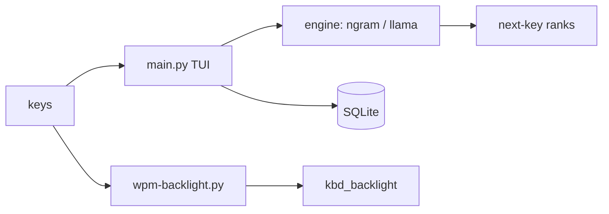

<p align="center"></p>

> Predicts your next key from your own typing, and turns your typing speed into keyboard backlight.

*Logo is a proposal, pending owner sign-off.*

<!-- TODO: add a real TUI screenshot (assets/screenshot-tui.png) once PR #1 lands. -->

## What it does

`keytypist` renders an on-screen keyboard and guesses your next character as you type. Each keystroke and prediction is logged to a local SQLite database.

Engines (`--engine`):
- `ngram` (default): in-memory character n-gram trained from local history. No dependencies.
- `llama`: [llama-cpp-python](https://github.com/abetlen/llama-cpp-python) with a local `.gguf` model.
- `llama-server`: a running llama.cpp server (`--host`, `--port`).

`wpm-backlight` is a companion daemon: it reads `/dev/input/event*`, computes rolling WPM and writes keyboard backlight brightness under `/sys/class/leds/`. Faster typing gives a brighter keyboard.



## Install

```bash
python3 -m venv .venv && source .venv/bin/activate
pip install llama-cpp-python   # optional, llama engines only
```

Backlight daemon (needs `python3-evdev`, root):

```bash
sudo ./install.sh
```

Known limits: the daemon targets `dell::kbd_backlight`, and `install.sh` and `keytypist-wpm.service` contain a hardcoded home path that you must edit for your machine. See [ROADMAP.md](ROADMAP.md) U1.

## Quick start

```bash
python3 main.py                                  # n-gram engine
python3 main.py --engine llama --model /path/to/model.gguf
python3 main.py --smoke                          # non-curses check
```

Data lives in `~/.config/keytypist/` (`corpus.txt`, `keytypist.db`, `keytypist.log`).

## Status

Early. Plan: [ROADMAP.md](ROADMAP.md). Design: [DESIGN.md](DESIGN.md). Landscape: [docs/research](docs/research/2026-10-10-landscape.md).

## Contributing

Small PRs welcome; run `python3 -m py_compile main.py wpm-backlight.py` and `python3 main.py --smoke`.

## License

MIT, see [LICENSE](LICENSE).
